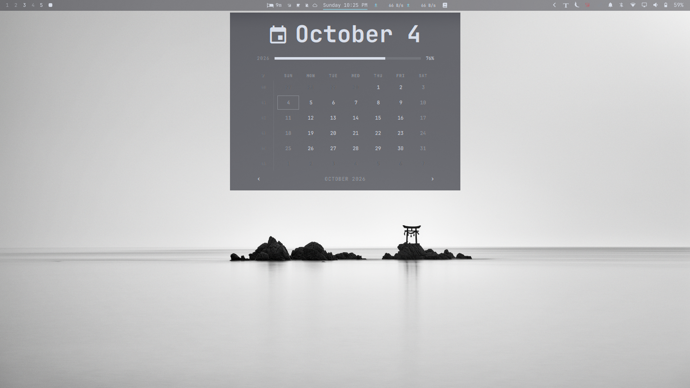

# Mac-blur-quattro

A dark, Mac-inspired glass theme for Omarchy Quattro, based on the
Nord Night palette and a complete saved desktop configuration.



## Install

Requires Omarchy 4.x with Lua-configured Hyprland.

```bash
omarchy theme install https://github.com/notzeman/Mac-blur-quattro
```

## Activate

```bash
omarchy theme set Mac-blur-quattro
```

## Appearance

- Theme-relative colors from `colors.toml`, with no fixed terminal tint.
- Native Omarchy bar at 35% opacity, with the tray on the right.
- Omarchy root and system menus at 55% opacity, with blurred borderless cards.
- Clipboard and emoji cards use the same blur, with a clear desktop outside them.
- Hover tooltips fully clear.
- Hyprland blur size 7 with 3 passes.
- Ghostty at font size 8 and 30% background opacity with perceptual per-cell fading.
- White Ghostty cursor and animated white GLSL trail.
- LookElsewhere in the center: 25-minute focus intervals, 20-second breaks,
  and a 3-minute long break every fourth break.
- Bibata Original Classic pointer at size 18.
- Night light starts at 5500K.
- Wolfykq-inspired Hyprlock layout with a 12-hour clock, no seconds, and blurred wallpaper.
- Theme-aware GTK3/GTK4 glass dialogs, menus, and popovers with readable controls.

The theme uses Omarchy's generated application palettes. Its shell surface
colors refer to palette roles, so edits to `colors.toml` remain dynamic.

## Saved configuration

`config-snapshot/` contains the current working user configuration, including
the latest menu and clipboard blur fixes:

- `ghostty/`: terminal configuration, appearance override, and white trail shader.
- `hypr/`: personal Hyprland configuration, blur rules, bindings, and autostart.
- `hypr/hyprlock.conf` and `hypr/hyprlock/`: modular lock layout and theme-aware helper scripts.
- `omarchy/shell.json`: native-bar layout and plugin settings.
- `omarchy/plugins/zaman.lock/`: Hyprlock adapter for Omarchy's manual, idle, and suspend lock IPC.
- `omarchy/themed/shell.toml.tpl`: global shell appearance template.
- `omarchy/hooks/theme-set.d/99-bibata-pointer.sh`: mouse-pointer preference.
- `gtk-3.0/` and `gtk-4.0/`: mouse-pointer settings and GTK glass stylesheet imports.
- `omarchy/gtk/` and `omarchy/hooks/theme-set.d/10-gtk.sh`: glass styles and palette generation.
- `omarchy/scripts/brightness-zero-dpms`: turns the display off at 0% backlight.
- `systemd/user/omarchy-brightness-zero-dpms.service`: runs the brightness watcher.
- `xdg-terminals.list`: Ghostty as the default terminal.

Selecting the theme applies its palette, wallpapers, and shell appearance.
The saved Hyprland and Ghostty files provide the rest of the setup.

### Apply the saved appearance configuration

Copy `config-snapshot/ghostty/` to `~/.config/ghostty/` for font size 10,
55% transparency, and the white cursor-trail shader. Paths use `~/` so they
work with any username.

Copy or merge `config-snapshot/hypr/looknfeel.lua` into your personal
`~/.config/hypr/looknfeel.lua` to enable the included terminal, bar, flyout,
menu, clipboard, and emoji blur rules. Omarchy's main Hyprland config must
load this module with `require("hypr.looknfeel")`.

`config-snapshot/omarchy/shell.json` contains the bar layout and plugin settings.
The remaining snapshot files provide the pointer settings, night-light
autostart, keyboard shortcuts, and original monitor/input preferences.

Apply changes with:

```bash
omarchy default terminal ghostty
hyprctl reload
hyprctl configerrors
omarchy restart terminal
omarchy restart shell
```

Ghostty, hyprsunset, hyprlock, the Bibata Original Classic cursor theme, and the third-party
plugins referenced in `shell.json` need to be installed separately. Plugin
source other than the included Hyprlock adapter, packages, clipboard history,
and scheduler state are not bundled.

The hotspot widget in the saved bar is
[omarchy-hotspot](https://github.com/chillboy0101/omarchy-hotspot). Install it,
then run its one-time system setup (one administrator authentication) from a
terminal or the panel's **Set up hotspot** action:

```bash
omarchy plugin add https://github.com/chillboy0101/omarchy-hotspot.git --enable
~/.config/omarchy/plugins/io.github.chillboy0101.omarchy-hotspot/install.sh
```

Setup adds `hostapd`, `dnsmasq`, a root-owned helper, and a polkit rule. It
requires a Wi-Fi driver that can run station and AP interfaces concurrently;
the helper's `status` command confirms the connection without a password.

### Display off at 0% brightness

Some panels still emit light at a backlight value of 0%, so 0% alone does not
blank the screen. The included watcher turns the display off with DPMS at 0%
and turns it back on when brightness rises above 0%. It also re-asserts off
when idle or lock wake relights a 0% panel.

Copy `config-snapshot/omarchy/scripts/brightness-zero-dpms` to
`~/.config/omarchy/scripts/` and
`config-snapshot/systemd/user/omarchy-brightness-zero-dpms.service` to
`~/.config/systemd/user/`, then enable it:

```bash
chmod +x ~/.config/omarchy/scripts/brightness-zero-dpms
systemctl --user daemon-reload
systemctl --user enable --now omarchy-brightness-zero-dpms.service
```

`omarchy brightness display off` and `on` still work manually. Hyprland's Lua
DPMS dispatcher has no per-monitor target, so the 0% rule affects every
connected display.

### Hyprlock

The layout is adapted from
[wolfykq/dotfiles](https://github.com/wolfykq/dotfiles/tree/main/.config/hypr).
It retains the centered time, date, and password-field arrangement, with
installed-font fallbacks and a media label positioned to fit different outputs.

Copy `config-snapshot/hypr/hyprlock.conf` and `config-snapshot/hypr/hyprlock/`
into `~/.config/hypr/`, and copy the included `zaman.lock` directory into
`~/.config/omarchy/plugins/`. Then enable its supported built-in lock clone:

```bash
omarchy plugin enable zaman.lock
omarchy restart shell
```

**Super+Ctrl+L**, `omarchy system lock`, the System menu, idle locking, and
suspend locking use this adapter. The clock displays `03:45 PM`, without
seconds. Hyprlock applies its own background blur with size 7 and 3 passes;
it uses the current Omarchy wallpaper and refreshes palette colors before
every lock. The optional media label uses `playerctl` when available.

### GTK dialogs and popups

The GTK setup uses [adw-gtk3](https://github.com/lassekongo83/adw-gtk3) as the
GTK3 base theme, plus user CSS supported by GTK3 and GTK4. Install the base
theme with `omarchy pkg add adw-gtk-theme`, or extract its official release
archive into `~/.local/share/themes/`.

Copy the snapshot's `gtk-3.0/gtk.css`, `gtk-4.0/gtk.css`, and `omarchy/gtk/`
into the corresponding directories under `~/.config/`. Install the saved
`10-gtk.sh` theme hook to keep palette colors synchronized:

```bash
omarchy hook install theme-set ./config-snapshot/omarchy/hooks/theme-set.d/10-gtk.sh
bash ~/.config/omarchy/hooks/theme-set.d/10-gtk.sh
```

Native dialog and popup backgrounds use 55% opacity; text, icons, and buttons
retain their own opacity. GTK4/libadwaita surfaces that are embedded within an
application instead of separate popup windows follow that application's rendering.
Restart already-running applications to load the repaired GTK stylesheets.

The saved legacy `omarchy/hooks/theme-set` was also updated to use the current
state directory and Omarchy's normalized color lookup, avoiding invalid `#;`
CSS colors with palettes that do not store raw `color0`…`color15` keys.

### Third-party plugin patches

`config-snapshot/patches/` carries local fixes for cloned plugins so they can
be reapplied after a plugin is reinstalled or updated. Each `*.patch` applies
with `git apply` inside the plugin directory at the revision named by the
matching `*-base.txt` file:

```bash
git -C ~/.config/omarchy/plugins/io.github.amikeal.battery-plus \
  apply config-snapshot/patches/io.github.amikeal.battery-plus-charging-state.patch
omarchy restart shell
```

The battery-plus patch fixes the charging indicator: corrected charging
glyphs, a plug icon with `PLUGGED IN · NOT CHARGING` for an AC-connected idle
battery, and accurate tooltip and panel status labels. Apply it from the
repository root, or from wherever the snapshot was cloned.

## Wallpapers

Theme wallpapers are in `backgrounds/`, numbered `00.png` through `21.png` in
alphabetical order of their original filenames. After adding or renaming files
there, refresh the active theme and picker cache:

```bash
omarchy theme refresh
omarchy theme bg cache
```

For additions that should appear without refreshing the theme, use
`~/.config/omarchy/backgrounds/mac-blur-quattro/`.
